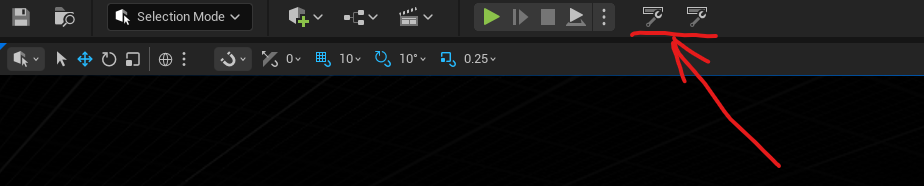

# 🛡️ TabGuardUE5

**Crash-safe auto-save & one-click restore of open asset tabs for Unreal Engine 5.8.**
**Краш-сейф автосейв и восстановление открытых вкладок редактора Unreal Engine 5.8 в один клик.**

   



---

<p align="center">
  <a href="#-русский"><b>🇷🇺 Русский</b></a>
  &nbsp;&nbsp;|&nbsp;&nbsp;
  <a href="#-english"><b>🇬🇧 English</b></a>
</p>

> GitHub не выполняет JS/CSS в README, поэтому «табы» здесь — это быстрый переключатель-якорь выше: клик переносит к нужному языку.
> GitHub doesn't run JS/CSS in READMEs, so the "tabs" above are a quick anchor switcher: click jumps to your language.

---

## 🇷🇺 Русский

### Проблема

Редактор UE после краша часто **теряет открытые вкладки**:

- закрыл проект и тут же перезагрузил ПК — вкладки пропали;
- движок крашнулся после закрытия — конфиги layout затёрты;
- штатный диалог «Restore tabs?» появляется не всегда.

### Решение

**TabGuard** — Editor-плагин, который:

1. **Автосохраняет список открытых ассетов** при каждом открытии/закрытии вкладки (дебаунс 0.5 с) в свой файл `Saved/TabGuard/TabSnapshot.json` (+ ротация `.bak`) — движок этот файл не трогает, поэтому снапшот переживает краши и wipe конфигов;
2. Добавляет кнопки **Save Tabs** и **Restore Tabs** на тулбар Level Editor (секция `User`) и в меню **Window** — после краша вкладки возвращаются в один клик;
3. Даёт **5 слотов**: можно вручную сохранить текущий набор вкладок в слот и загрузить его обратно одним кликом — например, «набор для AI», «набор для ландшафта» и т.д.;
4. Не влияет на упакованную игру (модуль только `Type: Editor`).

### Как это работает

```
Ассет открыт/закрыт → UAssetEditorSubsystem::OnAssetOpened/Closed
                    → через 0.5 с пишется Saved/TabGuard/TabSnapshot.json
                      (предыдущий снапшот → TabSnapshot.bak.json)

Крах / потеря layout → кнопка Restore Tabs
                    → читает снапшот, пропускает уже открытое
                    → UAssetEditorSubsystem::OpenEditorForAsset() для остального
```

### Установка

1. Скопируй содержимое репозитория в `ТвойПроект/Plugins/TabGuard/` (файл `TabGuard.uplugin` должен лежать прямо в `Plugins/TabGuard/`).
2. Перегенерируй файлы проекта (правой кнопкой по `.uproject` → *Generate Visual Studio project files*) и собери `Development Editor`, либо просто открой проект — редактор предложит собрать недостающий модуль.
3. Проверь, что плагин включён: **Edit → Plugins → Project → Editor → TabGuard**.

### Использование

- **Save Tabs** — принудительно сохранить снапшот прямо сейчас (обычно не нужно: автосейв уже работает).
- **Restore Tabs** — переоткрыть вкладки из снапшота. Несуществующие/удалённые ассеты тихо пропускаются, уже открытые не дублируются.
- Снапшот: `Saved/TabGuard/TabSnapshot.json`:

```json
{
  "Version": 1,
  "SavedAt": "2026-10-12T10:30:00.000Z",
  "Project": "KingdomOfIsrion",
  "Assets": [
    "/Game/Maps/Main.Main",
    "/Game/Blueprints/BP_Hero.BP_Hero"
  ]
}
```

### Слоты

Помимо автосохранения есть **5 ручных слотов** (`Saved/TabGuard/Slots/Slot1..5.json`):

- Открой выпадающее меню **Slots** на тулбаре Level Editor (рядом с Save/Restore Tabs) или **Window → TabGuard Slots**.
- **Save to Slot N** — сохранить текущий набор открытых вкладок в слот (перезаписывает содержимое слота).
- **Slot N — 3 tab(s), 12.10.2026 14:05 UTC** — загрузить набор из слота; пункт серый, пока слот пуст.
- В подсказке пункта сохранения видно, что сейчас лежит в слоте и сколько вкладок будет перезаписано.
- Количество слотов меняется одной константой `MaxSlots` в `TabGuardSubsystem.h`.
- У слотов нет собственного автосейва — это осознанно: слот фиксирует набор вкладок на момент явного сохранения и не меняется, пока ты сам не перезапишешь его.

### Совместимость

- Unreal Engine **5.8**, **Win64**, только Editor. Собран и проверен через `UnrealBuildTool` (`Result: Succeeded`).
- Восстанавливаются именно **ассет-вкладки** (самый частый кейс потери). Пиксель-в-пиксель раскладку `FTabManager` плагин не сохраняет осознанно: её `InstanceId` сессионно-зависимы и ненадёжны после краша.

### Структура

```
TabGuardUE5/
├── TabGuard.uplugin
├── Source/TabGuard/
│   ├── TabGuard.Build.cs
│   ├── Public/TabGuardSubsystem.h   ← сейв/рестор снапшота
│   ├── Public/TabGuardModule.h
│   ├── Private/TabGuardSubsystem.cpp
│   └── Private/TabGuardModule.cpp   ← кнопки Save/Restore в тулбаре и Window-меню
└── README.md
```

---

## 🇬🇧 English

### Problem

After a crash, the UE editor often **loses open tabs**:

- closed the project and instantly rebooted the PC — tabs are gone;
- the engine crashed after shutdown — layout configs wiped;
- the built-in "Restore tabs?" dialog doesn't always show up.

### Solution

**TabGuard** is an Editor plugin that:

1. **Auto-saves the list of open assets** on every tab open/close (0.5 s debounce) into its own file `Saved/TabGuard/TabSnapshot.json` (plus `.bak` rotation) — the engine never touches this file, so the snapshot survives crashes and config wipes;
2. Adds **Save Tabs** and **Restore Tabs** buttons to the Level Editor toolbar (`User` section) and the **Window** menu — one click brings tabs back after a crash;
3. Provides **5 slots**: manually store the current tab set into a slot and load it back with one click — e.g. an "AI set", a "landscape set", etc.;
4. Never affects the packaged game (`Type: Editor` module only).

### How it works

```
Asset opened/closed → UAssetEditorSubsystem::OnAssetOpened/Closed
                    → 0.5 s later writes Saved/TabGuard/TabSnapshot.json
                      (previous snapshot → TabSnapshot.bak.json)

Crash / layout loss → Restore Tabs button
                    → reads snapshot, skips already-open assets
                    → UAssetEditorSubsystem::OpenEditorForAsset() for the rest
```

### Installation

1. Copy this repo into `YourProject/Plugins/TabGuard/` (`TabGuard.uplugin` must sit directly in `Plugins/TabGuard/`).
2. Regenerate project files (right-click `.uproject` → *Generate Visual Studio project files*) and build `Development Editor`, or just open the project — the editor will offer to build the missing module.
3. Make sure the plugin is enabled: **Edit → Plugins → Project → Editor → TabGuard**.

### Usage

- **Save Tabs** — force a snapshot right now (rarely needed: auto-save already runs).
- **Restore Tabs** — reopen tabs from the snapshot. Missing/deleted assets are silently skipped, already-open ones are not duplicated.
- Snapshot file: `Saved/TabGuard/TabSnapshot.json` (format shown in the Russian section above).

### Slots

In addition to auto-save there are **5 manual slots** (`Saved/TabGuard/Slots/Slot1..5.json`):

- Open the **Slots** dropdown on the Level Editor toolbar (next to Save/Restore Tabs) or **Window → TabGuard Slots**.
- **Save to Slot N** — store the current set of open tabs into the slot (overwrites its content).
- **Slot N — 3 tab(s), 12.10.2026 14:05 UTC** — load the set from the slot; the entry is grayed out while the slot is empty.
- The save entry's tooltip shows what the slot currently holds and how many tabs would be overwritten.
- The number of slots is a single constant: `MaxSlots` in `TabGuardSubsystem.h`.
- Slots have no auto-save of their own — by design: a slot freezes the tab set at the moment you explicitly save it and never changes until you overwrite it yourself.

### Compatibility

- Unreal Engine **5.8**, **Win64**, Editor only. Built and verified via `UnrealBuildTool` (`Result: Succeeded`).
- Restores **asset tabs** (the most common loss case) by design. Pixel-perfect `FTabManager` layout is intentionally not saved: its `InstanceId`s are session-dependent and unreliable after a crash.

---

## 📄 License

MIT — do whatever you want.
